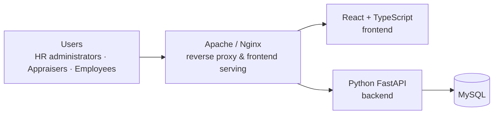

# Hi, I'm Hasrinah 👋

**Software Development · Automation · System Engineering · IoT**

I build and deploy web applications end to end: the interface, the API, the database and the server setup around them.

---

## 🧑‍💻 About Me

- 🔭 **Main project:** an internal **Performance Appraisal System**. It has a React + TypeScript frontend and a Python FastAPI backend, uses MySQL, and is deployed with Docker Compose behind Apache / Nginx.
- ⚙️ **Automation:** n8n workflows for PDF reporting, HR approvals and IoT sensor monitoring; automated frontend and backend regression testing; and file-processing tools that generate integrity hashes and encrypt data.
- 🖥️ **System engineering:** containerised deployment, reverse-proxy setup and frontend serving.
- 📚 **Also on GitHub:** projects in **Java Spring Boot**, **PHP** and **Node.js / Express**.

---

## 🌟 Featured Project

### Performance Appraisal System
*Full-stack internal web application · private repository*

A web platform for running staff performance appraisals, with separate access for HR administrators, appraisers and employees.

| Area | Capability |
|---|---|
| 🔐 **Access control** | Role-based authentication for HR administrators, appraisers and employees |
| 🏢 **Organisation data** | Employee and company management |
| 🔄 **Appraisal cycles** | Cycle management; employees can be added to an active cycle without affecting existing appraisal records |
| 📝 **Assessments** | Employee self-assessments, appraiser reviews and independent assessments |
| 📊 **HR oversight** | Monitoring and reporting, with PDF and Excel exports |
| 🌐 **Localisation** | English, Chinese and Malay |
| ✅ **Quality** | Automated frontend and backend regression testing |

**Architecture overview**

Deployed with Docker Compose · version-controlled with Git and GitHub

> 🔒 The source code, data and deployment details are confidential. This section is a high-level summary only.

---

## 🏆 Award-Winning Project

### Smart Visitor Management System for an Animal Garden
*Final Year Project · IoT*

An IoT system that counts visitors automatically and shows real-time crowd information, to help manage visitor flow.

- Built an IoT visitor-monitoring system with a NodeMCU ESP8266 and infrared sensors
- Automated visitor counting, with real-time crowd information shown on LCD screens
- Sent sensor data to Firebase over HTTP for real-time storage and retrieval
- Designed for crowd monitoring and better visitor-flow management

**Awards**
- 🥇 **Most Innovative and Creative Award**, Engineering Science & Technology Exhibition 2025 (ESTE'25), MAHSA University
- 🏅 **Fourth Place**, Malaysia Network Idea Competition 2024, Department of Communication Technology and Network, FSKTM, UPM

---

## 📂 Public Projects

| Project | Description | Stack |
|---|---|---|
| [**n8n-automation-workflows**](https://github.com/hasrinah/n8n-automation-workflows) | n8n workflows: daily QC reports turned into PDFs and sent to Telegram, an early-leave approval flow with Approve/Reject email buttons, and hourly IoT temperature monitoring from InfluxDB | n8n · JavaScript · MySQL · InfluxDB · Google Sheets · Gmail · Telegram |
| [**Customerapp**](https://github.com/hasrinah/Customerapp) | One-page customer management (CRUD) app with a layered controller → service → repository design and MySQL persistence | Java 17 · Spring Boot · Spring Data JPA · Thymeleaf · MySQL · Maven |
| [**secure-db-file**](https://github.com/hasrinah/secure-db-file) | Takes pipe-delimited `.unl` data files, writes per-field MD5 integrity files, encrypts each field with AES-256-CBC (OpenSSL) and shows decrypted records in a paginated DataTables view | PHP · OpenSSL · jQuery · DataTables |
| [**resume-analyzer**](https://github.com/hasrinah/resume-analyzer) | Node.js API that accepts PDF résumé uploads and extracts their text | Node.js · Express · Multer · pdf-parse |

---

## 🛠️ Tech Stack

| Area | Technologies |
|---|---|
| **Languages** |        |
| **Frontend** |    |
| **Backend** |     |
| **Database** |  |
| **DevOps & Infrastructure** |     |
| **IoT & Cloud** |    |
| **Tools** |     |

---

## 📈 GitHub Activity

<picture>
  <source media="(prefers-color-scheme: dark)" srcset="https://github-readme-stats.vercel.app/api?username=hasrinah&show_icons=true&hide_rank=true&hide_border=true&theme=dark">
  
</picture>
<picture>
  <source media="(prefers-color-scheme: dark)" srcset="https://streak-stats.demolab.com?user=hasrinah&hide_border=true&theme=dark">
  
</picture>

<!--
## 📫 Connect
Uncomment and fill in only the channels you want to share publicly.
- LinkedIn: https://www.linkedin.com/in/<your-handle>
- Email: <your-public-email>
-->
